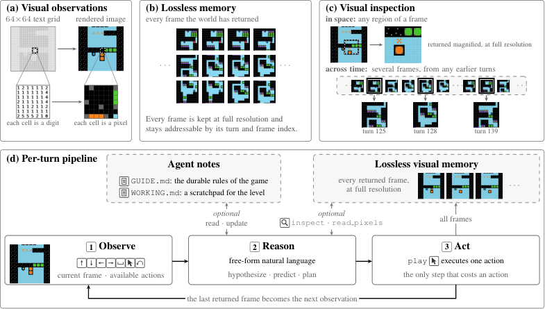

# VISTA Reading Notes

- Paper: **VISTA: A Visual Harness for Reasoning in an Interactive World**
- Authors: Qiushi Han, Keya Hu, Linlu Qiu, Cathy Wu, and Kaiming He (MIT)
- Original: [PDF](https://arxiv.org/pdf/2610.02200) · [HTML, arXiv v1](https://arxiv.org/html/2610.02200v1)
- Version reviewed: 2026-10-01; reading started: 2026-10-12
- Authors' code: [joshhhhhan/VISTA](https://github.com/joshhhhhan/VISTA)
- Scope: Initial paper-based reading; reported results have not been independently reproduced.

## 1. Problem and Main Contributions

**Can a multimodal agent reason more effectively by revisiting original visual evidence, rather than relying only on what survived its first encoding and context compaction?**

An observation may contain details whose importance becomes apparent only later. A compressed visual representation or textual summary can omit those details. VISTA addresses this at the **agent-harness level**: it archives original observations and gives an existing multimodal model tools to retrieve, crop, enlarge, and compare them as its reasoning develops.

Its three central components are:

1. **Visual observations:** provide rendered images instead of requiring textual state grids.
2. **Lossless visual memory:** preserve every frame returned by the environment, including intermediate animation frames, outside the model's bounded context.
3. **Model-directed inspection:** let the model choose which previous frames and spatial regions to revisit, with exact pixel readout when needed.

The authors report perfect or near-perfect action-efficiency scores on the 25 public ARC-AGI-3 games and improvements on three other benchmarks. The contribution is a reusable inference-time interface and memory design; the harness itself adds no trained neural module or new training loss. [§1 and §3](https://arxiv.org/html/2610.02200v1#S3)

## 2. Method: Pipeline, Worked Example, and Context Management

**Overview.** VISTA wraps an existing multimodal model in a host-side harness that connects it to the environment, preserves visual evidence, and executes tools. The model supplies perception, reasoning, and action selection; the harness supplies storage and interaction mechanisms. No VISTA-specific training or fine-tuning of the model is described.

At each turn, the model receives the current image and available actions. It can read its notes, retrieve past action records, or inspect earlier frames and enlarged regions. It then chooses an action and states its expected outcome. The harness executes the action, archives every returned frame—including intermediate animation frames—and returns the final frame as the next observation. The model compares the outcome with its expectation and can revise its hypotheses and notes before continuing.

```text
Current frame + available actions
             ↓
Multimodal model: observe, form hypotheses, and plan
             ↔ optional tools: read notes / query history / inspect images
             ↓
Select an action → harness executes it → environment returns frames
                                             ↓
                                  Archive every returned frame
                                             ↓
                      Return final frame; compare outcome with prediction
                                             ↓
                              Revise notes and continue
```



*Figure 3 from Han et al., VISTA, arXiv:2610.02200v1, reproduced unchanged under [CC BY 4.0](https://creativecommons.org/licenses/by/4.0/). [Original figure](https://arxiv.org/html/2610.02200v1#S3.F3).*

Panels (a)–(c) show the rendered observations, external frame archive, and spatial/temporal inspection. Panel (d) connects them to the observe–reason–act loop and the two persistent notes. This separates two problems: retrieving an old frame recovers evidence removed from context, while cropping and enlarging a region helps re-examine details that were not adequately perceived initially. Both operations can be combined on the same historical image. [§3](https://arxiv.org/html/2610.02200v1#S3)

### 2.1 Worked example: revising a hypothesis about a switch

**This is an illustrative scenario, not a recorded trajectory from the paper.** The calls below use simplified pseudocode based on the paper's tool interface; action labels and crop coordinates depend on the environment.

Suppose a game contains a door, a switch, and a movable box. The hidden rule is that the box must continuously press the switch to keep the door open. The model does not receive that rule.

**Step 1 — Observe and record a tentative hypothesis.** The model sees the objects and predicts that moving the box onto the switch will open the door. It can immediately write notes; it does not have to wait for the context to fill.

```text
write_guide(content=
  "Hypothesis, not yet confirmed: the switch controls the door.")

write_working(content=
  "The box is beside the switch. Next: move it onto the switch,
   then inspect whether the door opens.")
```

The model calls `play` with the relevant movement action. Suppose the harness labels the resulting observation as turn 12. The door is open, and all frames from that action are automatically archived. The model can record this observation without yet claiming that a single contact permanently opens the door.

**Step 2 — Act and notice a contradiction.** At turn 13, the model moves the box off the switch while trying to clear a route. The door closes. This contradicts a possible “one-time trigger” interpretation. The model now has a concrete question to investigate.

**Step 3 — Query action history, then inspect the evidence.** If it needs to locate the relevant turns, it first retrieves event records:

```text
history(view="events", start_turn=12, end_turn=14)
```

The interval includes turns 12 and 13. This returns action/result records, not the complete images or an archive of every reasoning step. The model uses the turn identifiers to request visual comparisons:

```text
inspect(
  question="Does the door close when the box leaves the switch?",
  views=[
    {label: "Before", turn: 12, frame: "final", region: "full"},
    {label: "After",  turn: 13, frame: "final", region: "full"}
  ]
)
```

If the switch is too small in the full frames, the model issues another `inspect` request with rectangular regions `{x, y, w, h}` covering it. It can also select an intermediate frame to examine how the transition unfolded. The harness retrieves and enlarges the requested images; **the model, not the harness, interprets the comparison**. Exact color questions can additionally use `read_pixels`.

**Step 4 — Revise durable knowledge and the current plan.** After comparing the frames, the model updates the notes with an evidence-linked rule and a separate operational plan:

```text
write_guide(content=
  "Evidence from turns 12–13: the door opened while the box occupied
   the switch and closed after it left. Working rule: continuous
   pressure is required. Keep checking this rule in later levels.")

write_working(content=
  "Turn 13: the door is closed and the box is off the switch.
   Next: return the box to the switch, confirm the door opens,
   then move the player toward the exit without moving the box.
   Relevant evidence: turns 12–13.")
```

These tools replace note contents, so a real update should retain other still-useful information. `GUIDE.md` holds reusable knowledge, while `WORKING.md` holds the current situation and plan. Updating either changes the information available to later model calls; it does not change model weights or automatically rewrite the system prompt.

**Step 5 — Continue across a context boundary if necessary.** If the context becomes full before the level is solved, the model saves a handoff with the current state, evidence references, and next action. A fresh context resumes from the same game state. It can read the notes and retrieve turns 12–13 again rather than replaying the entire game. Inspection can also occur before a failure; failure is not a prerequisite for using memory.

The example illustrates the paper's observation, prediction, inspection, and note-writing mechanism. It assumes only actions supported by the hypothetical environment; VISTA does not provide arbitrary rollback of game state. [§3.2 and Appendix A.4–A.5](https://arxiv.org/html/2610.02200v1#A1.SS4)

### 2.2 Tool calls and context management

**Who calls the tools?** The multimodal model chooses a structured function call, the host-side controller executes it, and the model receives the result. Plain text mentioning a tool does not execute it. The controller enforces sequential environment actions; a new `play` is accepted only after the previous action's result has returned.

| Tool | Returned information or effect |
|---|---|
| `play(action, ...)` | Executes one game action; returns the final frame, frame count, and available actions; archives intermediate frames |
| `inspect(question, views)` | Returns selected historical frames or enlarged crops |
| `read_pixels(question, views)` | Returns numerical color information from selected regions |
| `history(view="events", ...)` | Returns action/result records for a turn range |
| `history(view="attempts", ...)` | Returns attempt summaries, useful for locating previous trials |
| `read_guide()` / `write_guide(content)` | Reads or replaces reusable game knowledge |
| `read_working()` / `write_working(content)` | Reads or replaces current-level state and plans |
| `save_compact_checkpoint(...)` | Saves continuation notes in the paper's Codex integration before context restart |

The tools are exposed through MCP in the Claude Code integration and registered with the app server in the Codex integration. These are implementation details of the paper's harness, not requirements to train a new model. Its visual tools perform mechanical operations rather than answering the model's questions with a separate reasoning model. [Appendix A.4](https://arxiv.org/html/2610.02200v1#A1.SS4)

**What happens before the context limit?** Reading notes, inspecting evidence, and writing notes are optional, model-directed steps during ordinary interaction. The model can update a rule as soon as it learns something important; neither file must be updated after every action.

**What happens at the context limit?** The controller pauses normal tool use and requests a continuation checkpoint. The agent saves the information needed to resume, then continues in a fresh context with its notes, action history, and current frame. Original frames remain available in the external archive. Context restart does not reset the environment, although the experiment still imposes overall action and runtime budgets.

| Information | Treatment across context compaction |
|---|---|
| Original returned images | Preserved externally and retrievable by turn/frame |
| Action/result history | Retained as structured records |
| `GUIDE.md` and `WORKING.md` | Retained to carry forward rules, state, and plans |
| All old images simultaneously in active context | Not required and not guaranteed |
| Complete step-by-step reasoning | Not promised as a lossless, retrievable memory; notes and summaries retain selected conclusions and plans |

**Lossless evidence is not perfect recall.** The model can lose an interpretation or omit an important fact from a summary even while the original image remains stored. Recovery still depends on realizing that evidence is needed, locating it, and interpreting it correctly. The retrieval mechanism is not a new neural attention layer.

Within a game, `GUIDE.md` carries knowledge across levels. `WORKING.md` survives resets and context restarts but is cleared when the level advances. The paper does not describe carrying one game's notes into another game. For independent static BabyVision questions, persistent notes are omitted. [§3.2 and Appendix A.4–A.5](https://arxiv.org/html/2610.02200v1#S3.SS2)

Long context is helpful but does not replace this mechanism. The paper's default is 200K tokens; reducing it to 100K loses only 0.4 RHAE points while roughly halving token usage. This supports reduced dependence on a larger active context, not a claim that very short contexts suffice. Detailed context ablations appear in Section 3.3 below.

## 3. Evaluation: Metrics, Baselines, Ablations, and Generalization

### 3.1 What is RHAE?

ARC-AGI-3 is an interactive benchmark rather than a static question-answering dataset. Agents observe game frames, choose available actions, and use feedback to infer unfamiliar rules and goals. VISTA evaluates **25 public games**, each with multiple levels. Models retain their pretrained capabilities; the setup does not establish that they have never encountered these public games.

**Relative Human Action Efficiency (RHAE)** measures both level completion and the number of environment actions needed, relative to first-time human players. It is not simply accuracy or completion rate.

For a completed level $\ell$ in game $g$:

$$
s_{\ell,g}=\min\left(1.15,\left(\frac{h_{\ell,g}}{a_{\ell,g}}\right)^2\right).
$$

Here $a_{\ell,g}$ is the agent's action count; $h_{\ell,g}$ is the upper-median action count among first-time human players who completed that level. An unfinished level scores zero.

| Example: human reference = 100 actions | Level score |
|---|---:|
| Agent finishes in 100 actions | 1.00 |
| Agent finishes in 200 actions | 0.25 |
| Agent finishes in 80 actions | 1.15, capped from 1.5625 |
| Agent does not finish | 0 |

For a game with $n$ levels, later levels receive larger weights, $w_\ell=\ell$. If the first $k$ levels are completed:

$$
S_g=\min\left(
\frac{\sum_{\ell=1}^{k}w_\ell}{\sum_{\ell=1}^{n}w_\ell},
\frac{\sum_{\ell=1}^{n}w_\ell s_{\ell,g}}{\sum_{\ell=1}^{n}w_\ell}
\right).
$$

The first term is weighted completion; the second is weighted action efficiency. Finally:

$$
\mathrm{RHAE}=100\times\frac{1}{25}\sum_{g=1}^{25}S_g.
$$

**Why is the maximum 100, despite the 1.15 level cap?** Weighted completion cannot exceed 1, and the minimum therefore caps every game at 1. Higher action efficiency helps until that cap is reached; it cannot lower the score, but additional gains eventually stop increasing it. The 1.15 cap is a scoring-rule choice, not a mathematical limit. VISTA adopts it without explaining why the bonus is exactly 15%.

Consequently, total action counts help distinguish systems that both score 100. Inspection calls and reasoning tokens are not equivalent to game actions: high RHAE does not establish low inference cost or latency. [§4.1 and Appendix A.3](https://arxiv.org/html/2610.02200v1#A1.SS3)

### 3.2 Baselines versus VISTA on ARC-AGI-3

The official minimal harness provides observations and available actions, lets the agent act repeatedly, and returns subsequent feedback. **It is not a single-attempt baseline.** Its history is bounded: the official implementation uses textual grids and discards the earliest turns after exceeding its context window, without VISTA's persistent visual archive and inspection interface.

| System | Backend | Reasoning effort | Program synthesis? | RHAE |
|---|---|---|---|---:|
| Official implementation | GPT-5.6 Sol | max | No | 13.33 |
| **VISTA** | GPT-5.6 Sol | max | No | **99.00** |
| Official implementation | Claude Opus 5.0 | high | No | 40.68 |
| **VISTA** | Claude Opus 5.0 | xhigh | No | **100.00** |
| Retrodict | GPT-5.6 Sol | max | Yes | 99.86 |
| Tycho | GPT-5.6 Sol | max | Yes | 100.00 |

Selected rows from Table 1. Both main VISTA backends complete all 25 games. Opus uses **7,302 actions**, versus the human reference of **17,135**, approximately **57.4% fewer**. GPT-5.6 Sol's three main runs yield **99.04 ± 0.17 RHAE** (mean ± standard deviation).

**“Without program” means without model-generated executable programs as the reasoning mechanism.** Program-synthesis competitors can encode inferred rules in code and execute or search that model. VISTA instead uses natural-language reasoning, visual evidence, and predefined tools. Its storage, inspection, and environment controller are still implemented in ordinary code.

**Comparison limits:** Opus reasoning effort differs between the official and VISTA rows. Access interfaces, interaction budgets, and context management also differ. The authors treat the published official results as external references; the headline differences are system-level comparisons rather than isolated measurements of visual memory's effect. [Table 1, Appendix A.1–A.2, and B.1](https://arxiv.org/html/2610.02200v1#S4.SS2)

### 3.3 VISTA ablation studies

**Progressively adding harness components.** Configurations (i)–(vi) use GPT-5.6 Sol at max effort through the same access interface. Each row adds to the preceding configuration.

| Configuration | Added capability | RHAE |
|---|---|---:|
| External official reference | Textual grids, minimal harness | 13.33 |
| (i) | Replace textual grids with images | 47.32 |
| (ii) | Increase action and time limits | 51.66 |
| (iii) | Continuous conversation with context compaction | 65.82 |
| (iv) | Persistent notes and a revisable game-model prompt | 70.05 |
| (v) | Lossless visual memory and inspection | 94.10 |
| (vi) | Exact pixel readout; full VISTA | **99.00** |

Our arithmetic: memory/inspection adds **24.05 RHAE points** over (iv); pixel readout adds another **4.90**. These sequential differences support the usefulness of the components in this setup, but are not independent additive contributions established by a factorial experiment.

The comparison also changes input scheduling: (i)–(iv) automatically receive up to seven frames per action, whereas (v)–(vi) receive the final frame and inspect archived frames on demand. The enlarged budget allows up to **2,000 actions and 48 hours per game**. Thus additional trial opportunities contribute some improvement, while subsequent gains remain after the budget increase. [Figure 5 and Appendix A.2](https://arxiv.org/html/2610.02200v1#S4.SS3)

**Representation, context length, and image scale.**

| Ablation | Reported finding | Interpretation |
|---|---|---|
| Images versus textual grids within VISTA | Comparable performance; 30.7M versus 71.9M tokens per game | Images reduce token use; text is not intrinsically incapable of solving the games |
| 200K versus 780K context | 200K achieves 99.00 RHAE; 780K consumes 105.7M tokens/game versus 30.7M | Larger active context does not automatically improve performance |
| Reduce context to 100K | RHAE falls by only 0.4 points; token use roughly halves | External memory reduces dependence on even larger context, although 100K is still substantial |
| 4× versus 8× image upscaling | Comparable performance with 75% fewer image tokens per frame at 4× | Input representation can be made cheaper |
| 2× or 16× upscaling | 2× hurts performance; 16× brings no additional benefit | More image tokens are not always useful; upscaling creates no new source detail |
| Render ARC games in 3D | 84.12 RHAE with 20,640 actions | Performance remains strong but visual complexity increases difficulty |

The context experiment measures when compaction occurs, not how many original frames remain in the external archive. Across context restarts, notes and raw frames stay available. [Figures 6–7 and 9, §4.3](https://arxiv.org/html/2610.02200v1#S4.SS3)

### 3.4 Other foundation-model backends: GLM

In addition to the closed-weight Claude and GPT backends, the authors test **GLM-5.3 Flash 320B**, an open-weight model. Figure 8 compares:

1. The official minimal harness, rerun with GLM.
2. VISTA with `inspect` and `read_pixels` removed.
3. Full VISTA, which reaches **66.93 RHAE**.

The authors report a substantial improvement over the official baseline. This provides evidence that the harness benefit is not exclusive to one closed-weight model. However, the result remains below the Claude/GPT configurations; the harness does not eliminate dependence on the foundation model's capabilities.

The GLM evaluation allows **3,000 actions per game**, versus 2,000 for the main Claude/GPT evaluations. Therefore these scores should not be treated as a perfectly budget-matched backend ranking. No VISTA-specific GLM fine-tuning is described. [Figure 8 and Appendix A.1](https://arxiv.org/html/2610.02200v1#S4.SS3)

### 3.5 Other evaluation environments: GameWorld, AI GameStore, and BabyVision

These are **benchmarks, not competing methods**. The authors apply VISTA with GPT-5.6 Sol and compare it with each benchmark's official minimal-harness implementation using the same underlying model.

| Benchmark | Evaluated scope | Metric and reported result |
|---|---|---|
| **GameWorld** | 34 browser games, 170 tasks | Three-run mean: **63.33 ± 2.37% success**, **79.30 ± 2.14% progress** |
| **AI GameStore** | 10 public browser games | Geometric mean of human-normalized scores; authors report exceeding the minimal-harness baseline and human median reference |
| **BabyVision** | 39 static visual-tracking questions: 20 mazes and 19 connecting-lines problems | Accuracy rises from **41.0% to 63.2%** |

**GameWorld:** the agent uses screenshots and keyboard/mouse actions. Success counts completed tasks; progress also credits partial completion. The official baseline includes the two previous steps in each request, and tasks have a 100-action limit. VISTA's reported human comparison uses the benchmark's novice player, not a broad population average.

**AI GameStore:** each game has its own score, normalized so the published human median is 100. The normalized game scores are combined geometrically, so this metric is neither RHAE nor success rate. Across repeated runs, raw scores are first averaged per game before normalization and aggregation; averaging final aggregate scores would not reproduce that protocol. The official loop has 120 decisions and pauses the game during inference.

**BabyVision:** the comparison is against one-shot image answering. VISTA can inspect crops and pixel values before answering, so this experiment supports visual inspection without a temporal memory archive. It also permits extra inference/tool use. The evaluation covers only 39 of the full benchmark's 388 questions; persistent game notes are omitted. The three-run mean is 63.23 ± 3.00%, consistent with the rounded 63.2% headline.

These results support transfer across several visual interfaces, but should not be merged into one common score: their task scopes, metrics, human references, and interaction budgets differ. [§5, Appendix A.1/A.3/A.6, and B.1](https://arxiv.org/html/2610.02200v1#S5)

## 4. Limitations and Our Interpretation

### 4.1 What does the action count include?

The reported total actions count environment interactions over the evaluated run, including exploration and unsuccessful attempts—not only the final successful solution path. RHAE instead uses per-level action counts relative to the human references before aggregating scores. Context compaction does not restart the game or erase previously incurred actions.

Starting a game does not mean starting with literally no context: the agent receives task/tool instructions, the initial observation, and available actions, and brings its pretrained capabilities. It develops game-specific knowledge through interaction and can reuse notes across levels. Prior exposure to the public games remains a separate uncertainty.

**Environment-action efficiency is not total problem-solving efficiency.** Reasoning, `inspect`, `read_pixels`, history queries, and note updates can consume computation between actions without counting as game actions. Thus fewer actions do not establish lower latency, token usage, or monetary cost. The reported 57.4% action reduction should not be interpreted as an equivalent reduction in overall computation. [§4.2 and Appendix A.3–A.4](https://arxiv.org/html/2610.02200v1#A1.SS3)

### 4.2 Reproducibility and variation in total actions

The authors release code and evaluate an open-weight GLM backend, facilitating independent reruns. However, **reproducing the method does not imply reproducing an identical action trajectory**. Even with the same model version, stochastic generation can change hypotheses, inspection requests, and action choices. Early differences can lead to different subsequent observations and exploration paths. Changes to a hosted model or its serving configuration would introduce an additional source of variation.

The paper repeats its main evaluations three times. For GPT-5.6 Sol on ARC-AGI-3:

| Run | RHAE |
|---|---:|
| 1 | 99.00 |
| 2 | 98.90 |
| 3 | 99.23 |
| Mean ± standard deviation | **99.04 ± 0.17** |

These results support stable RHAE for that configuration. **They do not establish equally stable action counts.** RHAE saturates, so runs with different action totals can receive the same or very similar scores. Appendix B.1 does not provide the corresponding three-run mean and standard deviation of ARC total actions. The single reported Opus action total therefore should not be treated as a guaranteed repeat-run result, and GPT's repeat-run score statistics should not be transferred to Opus. [Appendix B.1 and Table 2](https://arxiv.org/html/2610.02200v1#A2.SS1)

Our recommendation for stronger evidence is to report repeated-run total actions, completion rates, tokens, and wall-clock time under fixed model versions, reasoning settings, environment versions, and budgets. Failed or truncated runs should remain visible: fewer actions can reflect early termination rather than efficient problem solving. Distinguish action counts on successful runs from counts across all runs. This is a proposed evaluation improvement, not an experiment reported in the paper.

### 4.3 Other limits on the conclusions

| Limitation | Implication |
|---|---|
| **Public-benchmark exposure** | The authors acknowledge possible training exposure because models were released after the public benchmarks. Private or newly created games would provide stronger evidence of generalization. |
| **System-level baseline differences** | Opus reasoning effort, interaction budgets, context handling, observation format, and access interface differ across comparisons. The headline gain cannot be assigned entirely to visual memory. |
| **Specific human references** | ARC uses first-time successful players' action references; GameWorld's novice reference is one player. These are not universal measures of human capability. |
| **Evidence preservation is not perfect recall** | The model must recognize what to retrieve, locate it, and interpret it correctly. Notes can omit useful conclusions even while images remain archived. |
| **Growing external storage** | Preserving all returned frames increases storage requirements with interaction length. The archive does not make arbitrarily long tasks free. |
| **Limited transfer evidence** | Browser games and static puzzles do not establish reliable physical-world control or generalization to every visual interface. |

Public-benchmark exposure is explicitly acknowledged by the authors. The other points combine the reported protocols with our interpretation of their scope. [§6 and Appendix A](https://arxiv.org/html/2610.02200v1#S6)

**Our main takeaway:** VISTA separates durable evidence storage from the model's working context. Its practical contribution is enabling the agent to revisit original evidence as its hypotheses change. The ablations support that interface design, while leaving open how well its gains persist on genuinely unseen environments under matched compute budgets and across repeated action trajectories.
